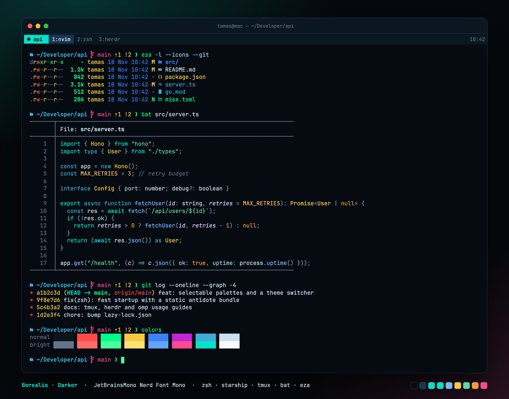

# dotfiles

[](https://github.com/tamasmarton/.dotfiles/actions/workflows/ci.yml)

macOS fejlesztői környezet [chezmoi](https://www.chezmoi.io/)-val, saját és céges gépre, valamint devcontainerbe.

**Gépek:** Mac (személyes, céges) · headless Debian/Ubuntu (SSH) · devcontainer

**Stack:** zsh + Starship · WezTerm (vagy Ghostty) + tmux · Neovim · VS Code (saját Borealis csomag) · mise (Node, Go, Java) · Claude Code, herdr, oh-my-pi · saját paletták (darker, nightfrost, bluehour) · JetBrainsMono Nerd Font

<p align="center">
  
</p>

<sub>A `darker` paletta: zsh + Starship, tmux, eza, bat, git, JetBrainsMono Nerd Font Mono. A kép generátora: [`docs/screenshots/render.py`](docs/screenshots/render.py) (`render.py darker`, vagy `--serve`, ha nincs GUI session a böngészőnek).</sub>


## Telepítés

### Új Mac

```sh
xcode-select --install          # git miatt
git clone https://github.com/tamasmarton/.dotfiles.git ~/Developer/.dotfiles
~/Developer/.dotfiles/install.sh
```

Az `install.sh` feltelepíti a chezmoit. Az **első kérdés a gép profilja** (a [`profiles/`](profiles/) mappa fájljai közül: `personal` vagy `work`), utána a Git név és email. Ha előre létrehozol egy [env fájlt](#profilok-és-gépspecifikus-adatok), nem kérdez semmit. Majd:

1. telepíti a Homebrew-t, ha még nincs,
2. kirakja a configokat a `$HOME`-ba,
3. a `Brewfile` alapján telepíti a csomagokat,
4. `mise install`: Node, pnpm, Go, Java,
5. megépíti és telepíti a Borealis VS Code csomagot (minden paletta egy téma),
6. bekapcsolja a herdr integrációt a Claude Code-hoz és az omp-hoz,
7. beállítja a macOS defaults-ot (billentyűismétlés, Finder, Dock, képernyőképek).

Egyetlen kézi lépés maradhat: a régi shell history importálása az atuinba (`atuin import auto`).

### Debian / Ubuntu szerver (headless, SSH-n át)

```sh
sudo apt install -y git curl
git clone https://github.com/tamasmarton/.dotfiles.git ~/Developer/.dotfiles
~/Developer/.dotfiles/install.sh
```

Ugyanaz a terminál, mint a Macen, GUI nélkül:

- **apt:** zsh, tmux, fordítóeszközök (a treesitter parserekhez). Ehhez egyszer sudo jelszót kér.
- **mise:** starship, fzf, eza, bat, fd, ripgrep, delta, lazygit, Neovim, sesh, yazi, btop, lazydocker, plusz Node LTS (a Neovim LSP-khez).
- **Claude Code CLI:** a hivatalos natív telepítővel (`~/.local/bin/claude`), ami magától frissül.
- **zsh lesz az alap shell** (`chsh`).
- **SSH kényelmi funkciók:**
  - a Neovimben és a tmuxban másolt szöveg a Mac vágólapjára kerül (OSC 52);
  - a tmux státuszsorban látszik a gép neve (beágyazott tmuxban `Ctrl-a Ctrl-a` a belső prefix);
  - a Starship mutatja a `user@host`-ot;
  - Ghostty-ból az SSH automatikusan rendezi a terminfo-t.
- **Debian 12** (régebbi glibc): a tree-sitter 0.25.10-en marad, az atuin helyett az fzf adja a `Ctrl-R`-t. **Debian 13-on** minden a legfrissebb.

### Devcontainer

A VS Code beállításaiba ezt a chezmoi magától beírja, így minden devcontainerbe automatikusan települ:

```json
"dotfiles.repository": "tamasmarton/.dotfiles",
"dotfiles.targetPath": "~/.dotfiles",
"dotfiles.installCommand": "install.sh",
"terminal.integrated.defaultProfile.linux": "zsh"
```

**Működés konténerben:**
- Nem kérdez, hanem az env fájlból vagy környezeti változókból dolgozik: `DOTFILES_PROFILE`, `DOTFILES_NAME`, `DOTFILES_EMAIL`, `DOTFILES_ENV_FILE`.
- **Kimarad:** a GUI-s részek és a runtime-ok (Node/Go/Java), mert azokat a projekt image adja.
- **Települ:** a terminál config, a CLI eszközök és a Claude Code CLI.

### Céges profil

- **Git email:** a fő email a céges. Ha megadsz személyes emailt (env fájl vagy init kérdés), a `personalGitDir` (alapból `~/Developer/personal/`, [`profiles/work.toml`](profiles/work.toml)) alatti repók automatikusan azt kapják (`includeIf`).
- **Céges CA tanúsítvány:** ha a cég TLS-t bontó proxyt használ, tedd ide: `~/.config/certs/corp-ca.pem`. A Node automatikusan használja; a git, curl és Java beállítása a [`work.zsh`](home/dot_config/zsh/work.zsh.tmpl)-ben van leírva.
- **Proxy és titkok:** a `work.zsh`-ban (titkokat 1Passwordből, `onepasswordRead`).
- **Céges csomagok:** a [`brewfile-work.rb`](home/.chezmoitemplates/brewfile-work.rb) "Céges" blokkjába (`brewfile edit gui`).

### Tesztek

- **CI:** minden pushnál lefut (GitHub Actions).
- **Végponttól végpontig:** az `install.sh` friss Debian 12, Debian 13 és VS Code devcontainer konténerben fut le, utána ellenőrzi a zsh-t, az eszközöket, a tmuxot, a Neovim + treesitter működését és a Claude Code-ot.
- **Helyben is futtatható:**

```sh
docker run --rm -v "$PWD":/src:ro debian:13 bash /src/test/e2e/linux-host.sh
docker run --rm -v "$PWD":/src:ro mcr.microsoft.com/devcontainers/base:debian bash /src/test/e2e/devcontainer.sh
```

## Napi használat

| Parancs | Mit csinál |
|---|---|
| `chezmoi edit ~/.zshrc` | config szerkesztése a forrásban |
| `chezmoi diff` | mi változna a `$HOME`-ban |
| `chezmoi apply` | változások kirakása |
| `chezmoi update` | `git pull` + apply |
| `chezmoi cd` | ugrás a repóba |

### Homebrew csomagok

A csomaglista három fájlban van:

| Fájl | Tartalma |
|---|---|
| [`Brewfile.tmpl`](home/dot_config/homebrew/Brewfile.tmpl) | a **terminálos rész**, minden Macen ugyanaz: formulák (git, mise, starship, tmux, neovim, lazygit, herdr, omp …) és az `omp` tap. Ez a `server` profil teljes Brewfile-ja |
| [`brewfile-personal.rb`](home/.chezmoitemplates/brewfile-personal.rb) | a **személyes gép GUI-s listája**: casks, taps, VS Code bővítmények, `lazydocker` (WezTerm, Ghostty, font, VS Code, Docker Desktop, Raycast, AeroSpace, Brave, Spotify, VLC …) |
| [`brewfile-work.rb`](home/.chezmoitemplates/brewfile-work.rb) | a **céges gép GUI-s listája**, a személyestől teljesen függetlenül. Alul a "Céges" blokkba jönnek a céges extra appok |

A két GUI-s lista **nem osztozik semmin**: egyik módosítása a másikat nem érinti, az átfedő sorok szándékosan mindkettőben benne vannak. A `gui = false` profilokon (`server`) egyik sem kerül be. Új GUI-s profilhoz (`gui = true`) kell egy `brewfile-<profilnév>.rb` is, különben a render hibát ad.

Szerkesztés: `brewfile edit` a terminálos részt nyitja, `brewfile edit gui` az aktuális profil GUI-s listáját; mentés után a `chezmoi apply` lefut, és ha változott a lista, a `brew bundle` telepíti az újat.

| Parancs | Mit csinál |
|---|---|
| `brewfile` | hiányzó csomagok telepítése (meglévőket nem frissít) |
| `brewfile upgrade` | `brew update` + elavultak frissítése |
| `brewfile check` | telepítve van-e minden |
| `brewfile cleanup` | ami telepítve van, de nincs a Brewfile-ban (csak lista) |
| `brewfile cleanup -f` | …és ezek eltávolítása, megerősítéssel |
| `brewfile edit` / `brewfile edit gui` | terminálos rész / a profil GUI-s listájának szerkesztése, majd apply |

## Felépítés

```
.
├── install.sh                  belépési pont (új gép, devcontainer)
├── .github/workflows/ci.yml    CI: minden profil renderelése és ellenőrzése, Neovim, témák, E2E
├── test/e2e/                   végponttól végpontig tesztek (Debian host, devcontainer)
├── nvim/lazy-lock.json         Neovim plugin verziók (a lazy.nvim ide írja)
├── profiles/                   profilok (personal.toml, work.toml), személyes adat nélkül
├── env.example.toml            minta a ~/.config/dotfiles/env.toml-hoz (gépenkénti név, email)
├── themes/                     színpaletták (darker.toml, nightfrost.toml, …)
├── theme                       paletta váltó: ./theme use <név>
├── vscode/tm-themes/           saját VS Code téma csomag (build.sh → .vsix)
├── .chezmoiroot                → a chezmoi forrás a home/ mappa
└── home/
    ├── .chezmoi.toml.tmpl      profil + env fájl + kérdések → gépenkénti adatok
    ├── .chezmoidata/theme.toml symlink az aktív palettára (themes/*.toml)
    ├── .chezmoitemplates/      VS Code téma sablon
    ├── .chezmoiignore          profil szerint kihagyott fájlok
    ├── .chezmoiscripts/        Homebrew, brew bundle, mise install, VS Code téma, herdr integráció, macOS defaults
    ├── dot_claude/             Claude Code: settings (merge), statusline, CLAUDE.md
    ├── dot_omp/                oh-my-pi: téma és config (merge)
    ├── .chezmoiexternal.toml   antidote (zsh pluginkezelő) git repóból
    ├── dot_zshenv              ~/.zshenv → XDG változók, ZDOTDIR=~/.config/zsh
    ├── dot_config/
    │   ├── zsh/                .zshrc, pluginok, aliasok, függvények, téma, work.zsh
    │   ├── git/                config (delta, aliasok, opcionális SSH aláírás), ignore
    │   ├── starship.toml.tmpl  prompt a palettából
    │   ├── mise/               Node LTS, pnpm, Go, Java (Temurin 25)
    │   ├── atuin/              kereshető history (Ctrl-R)
    │   ├── wezterm/            terminál (Lua), ghostty/ opcionális alternatíva
    │   ├── tmux/               josean-alapú config, a paletta színeivel
    │   ├── sesh/               tmux session-ök
    │   ├── herdr/              agent multiplexer téma (merge)
    │   ├── aerospace/          tiling ablakkezelő (opcionális)
    │   ├── nvim/               Neovim (josean-struktúra, modern pluginok)
    │   ├── bat/ eza/ lazygit/ btop/   a palettából színezve
    │   └── homebrew/           Brewfile (terminálos rész; a GUI-s lista profilonként: .chezmoitemplates/brewfile-*.rb)
    └── dot_local/bin/          saját parancsok (brewfile)
```

### Shell röviden

- **Pluginok** ([.zsh_plugins.txt](home/dot_config/zsh/dot_zsh_plugins.txt)): zsh-completions, fzf-tab, autosuggestions, fast-syntax-highlighting, history-substring-search
- **Billentyűk:** `↑`/`↓` keresés a beírt szövegre · `Ctrl-R` atuin · `Ctrl-T` fájl (fzf) · `Alt-C` mappa (fzf) · `Tab` fzf menü · `Ctrl-X Ctrl-E` parancs szerkesztése nvimben
- **`cd`** a zoxide-ot használja (`cd proj` → a leggyakoribb illeszkedő mappa), `cdi` interaktív
- **Runtime-ok:** `mise use node@20` a projektben, a `.nvmrc` / `.java-version` fájlokat is felismeri

### Téma

Minden szín egy **palettából** jön. A paletták a [`themes/`](themes/) mappában vannak, egy fájl egy téma. A témacsalád közös neve **Borealis** ([`brand.toml`](home/.chezmoidata/brand.toml)): a VS Code választóban `Borealis · <Paletta>` néven látszanak, így azonnal látod, melyik a tiéd. Az omp és a btop a paletta nevét használja.

| Paletta | VS Code neve | Jellemző |
|---|---|---|
| `darker` | Borealis · Darker | az **eredeti**: nagyon sötét, kontrasztos (≈ 14,6:1). A `03a360c` commitban készült, a színei azonosak, ne írd át |
| `nightfrost` | Borealis · Nightfrost | kékesfekete, kicsit visszafogottabb (≈ 10,5:1) |
| `bluehour` | Borealis · Bluehour | a VS Code Dark 2026 felépítése (semleges sötét szerkesztő, világosabb panelek, visszafogott kék accent), Tokyo Night-szerű kódszínekkel (≈ 9,5:1) |

#### Téma váltása

```bash
./theme                  # lista, az aktív *-gal
./theme use nightfrost   # az aktív paletta átállítása (a home/.chezmoidata/theme.toml symlink)
chezmoi apply            # életbe léptetés: minden alkalmazás újragenerálódik
```

Utána a futó programok újratöltése: VS Code `Developer: Reload Window`, Ghostty a konfig újratöltése, tmuxban `source-file ~/.config/tmux/tmux.conf`, a WezTerm magától újratölt, az omp új sessionben veszi át.

**Ideiglenes váltás apply nélkül** (a következő `chezmoi apply` visszaállítja az aktívra):

- VS Code: `Cmd+K Cmd+T`, majd a Borealis témák közül választasz
- omp: `/settings` → theme, vagy `omp config set theme.dark bluehour`
- btop: a `t` billentyű a menüben

**Melyik alkalmazás melyik témát tölti be**

| Alkalmazás | Téma | Hogyan állítható külön |
|---|---|---|
| WezTerm, Ghostty, tmux, Starship, Neovim, lazygit, eza, fzf, delta, Claude státuszsor | mindig az **aktív paletta** | csak `./theme use` (ezek egy színkészletet kapnak) |
| VS Code | aktív paletta | [`theme-overrides.toml`](home/.chezmoidata/theme-overrides.toml): `vscode = "darker"` |
| oh-my-pi (`omp`) | aktív paletta | `omp = "nightfrost"` ugyanott |
| btop | aktív paletta | `btop = "darker"` ugyanott |

Az üres érték az aktív palettát jelenti. Példa: a terminál legyen `darker`, a VS Code pedig `bluehour`:

```bash
./theme use darker
sed -i '' 's/^vscode = .*/vscode = "bluehour"/' home/.chezmoidata/theme-overrides.toml
chezmoi apply
```

**Új paletta:** másold le valamelyik `.toml`-t `themes/<új-név>.toml` néven, írd át a `name`-et és a színeket, majd `./theme use <új-név>`. Egy meglévő szín átírása után is elég a `chezmoi apply`. A bat és a delta szintaxis-kiemelése az `ansi` témát használja, vagyis a terminál 16 színét.

#### macOS Terminal.app (a sima beépített terminál)

A `chezmoi apply` minden palettából készít egy Terminal.app profilt a `~/.config/terminal-app/` mappába (`Borealis-Darker.terminal`, `Borealis-Nightfrost.terminal`, `Borealis-Bluehour.terminal`): a 16 ANSI szín, háttér, szöveg, kurzor, kijelölés és a JetBrainsMono Nerd Font Mono. A profilt egyszer kell importálni:

```bash
./theme terminal            # az aktív paletta profilját megnyitja (importálja)
./theme terminal bluehour   # vagy egy konkrétat
```

Utána Terminal ▸ Settings ▸ Profiles ▸ a profil ▸ **Default**. Az import nem írja felül a többi profilodat, és a chezmoi nem nyúl a Terminal.app beállításaihoz, így ez tudatos, kézi lépés marad.

**Korlátok:** a Terminal.app nem tud 24 bites színt, csak 256-ot. A Neovim kódszínei emiatt eltérhetnek a VS Code-tól, a tmux pedig Terminal.app alatt kevésbé pontos. A shell, a Starship, az `eza`, a `bat` és a `lazygit` a 16 ANSI színt használja, ezért ott a téma pontosan jön. Neovimhez a Ghostty vagy a WezTerm ajánlott. A VS Code beépített termináljához nem kell külön profil: az a VS Code téma ANSI színeit használja.

### VS Code

- **Téma:** saját [Borealis](vscode/tm-themes/) csomag: minden paletta egy téma (Borealis · Darker, Nightfrost, Bluehour). A felület és a kódszínezés is a palettából generálódik (`[theme]` és `[theme.syntax]`). A `chezmoi apply` újraépíti és telepíti, ha a színek változnak, és az aktív palettát állítja be színtémának.
- **Fájlikonok:** Material Icon Theme (a Brewfile telepíti), a mappák cyan, az általános fájlok tompa színnel.
- **Beállítások:** a chezmoi a `settings.json`-ban csak a témát, a fontot (JetBrainsMono Nerd Font) és néhány megjelenési beállítást írja. A többi beállításod megmarad.

### AI agentek: Claude Code, herdr, oh-my-pi

- **Claude Code:** a chezmoi a `~/.claude/settings.json`-ba csak a státuszsort írja (az aktív paletta színeivel), plusz a `theme`, `sandbox` és értesítés alapértékeket, ha még nincsenek. Az `env` (tokenek), `permissions`, `hooks` és `mcpServers` gépenként maradnak, és **soha nem kerülnek a repóba**.
- **Globális utasítások:** egy közös sablonból ([`agent-instructions.md`](home/.chezmoitemplates/agent-instructions.md)) generálódik a Claude Code `~/.claude/CLAUDE.md`-je és az oh-my-pi `~/.omp/agent/AGENTS.md`-je. Tartalma: nyelv, stack, a dotfiles működése; a gép típusa szerint (Mac / Debian host / devcontainer) és céges profilon kiegészül.
- **herdr:** agent multiplexer, több Claude / omp session egy helyen. Az aktív paletta témájával. A sidebarban látszik, melyik agent dolgozik, vár inputra vagy végzett.
- **oh-my-pi (`omp`):** coding agent TUI, az aktív paletta témájával és Nerd Font ikonokkal.
  - **Engedélyezés:** az omp alapból `yolo` módban mindent kérdés nélkül futtat, nálunk az alap a `write`. A fájlszerkesztés megy, a parancsok kérdeznek, kivéve amit a szabálylista enged:
    - **kérdés nélkül:** olvasó és teszt parancsok (`git status/diff/log`, `rg`, `go test`, `pnpm test/lint`, `./gradlew test` …);
    - **mindig kérdez:** `sudo`, `git push`, `git reset --hard`, `rm -rf`, `chezmoi apply`;
    - **tilos:** `rm -rf /` és `rm -rf ~`.
  - **Projektenként:** a `.omp/config.yml`-ben szigorítható, lazítani nem lehet.
  - **`RULES.md`:** a legfontosabb szabályok röviden; ezt az omp subagentjei is megkapják.
  - **Billentyűk:** a `Ctrl+L` újrarajzolja a képernyőt, nem az élő hangmódot indítja.
- A herdr, omp és Claude configot az alkalmazások maguk is írják, ezért a chezmoi ezeket nem írja felül, csak a saját kulcsait állítja be bennük (`modify_` sablonok).

### Opcionális appok

| App | Mire jó | Indítás |
|---|---|---|
| **Ghostty** | alternatív terminál, ugyanazzal a palettával | nyisd meg a Ghostty-t |
| **AeroSpace** | tiling ablakkezelő, `Ctrl-Opt` + `h/j/k/l`, workspace-ek `1–9` | nyisd meg az AeroSpace-t; nem indul el magától |
| **Raycast** | launcher a Spotlight helyett | első indításkor végigvezet a beállításon |

### tmux (prefix: `Ctrl-a`)

A tmux kezeli a session-öket: a terminálablak bezárása után is futnak a folyamataid (szerveren SSH-n át különösen hasznos).

**Alapok**

```bash
tmux                      # új session
tmux new -s api           # névvel
tmux ls                   # lista
tmux attach -t api        # visszacsatlakozás (vagy: tmux a)
```

Kilépés a sessionből úgy, hogy fut tovább: `Ctrl-a d` (detach). Az ablakok sorszáma 1-től indul, bezáráskor újraszámozódnak, és ha az utolsó ablakot zárod, a tmux egy másik sessionre vált (nem lép ki).

**Billentyűk** (először a prefix: `Ctrl-a`, aztán a billentyű)

| Billentyű | Mit csinál |
|---|---|
| `c` | új ablak az aktuális mappában |
| `\|` / `-` | függőleges / vízszintes split az aktuális mappában |
| `Ctrl-h/j/k/l` | mozgás panelek (és Neovim splitek) között, **prefix nélkül** |
| `h/j/k/l` (ismételhető) | panel átméretezése |
| `m` | panel zoom be/ki |
| `T` | session választó (sesh + fzf + zoxide) |
| `L` | előző session |
| `g` | lazygit popup az aktuális mappában |
| `Ctrl-s` / `Ctrl-r` | session mentése / visszaállítása (15 percenként automatikus, újraindítás után is) |
| `r` | config újratöltése |
| `Ctrl-a Ctrl-a` | a prefix továbbadása a beágyazott tmuxnak (SSH-n belüli tmux) |

**Másolás:** az egér be van kapcsolva; kijelölés után a szöveg a vágólapra kerül (SSH-n is, OSC 52-vel). Billentyűvel: `Ctrl-a [` (copy mode), `v` kijelölés kezdete, `y` másolás.

**sesh (session választó):** a `Ctrl-a T` listája a futó tmux sessionökből, a [`sesh.toml`](home/dot_config/sesh/sesh.toml.tmpl)-ban felvett fix sessionökből (pl. `dotfiles`) és a zoxide mappáiból áll. A választóban: `Ctrl-a` minden, `Ctrl-t` csak tmux, `Ctrl-x` zoxide, `Ctrl-f` mappakeresés, `Ctrl-d` session bezárása. Új fix session: új `[[session]]` blokk a `sesh.toml`-ban (`name`, `path`, opcionálisan `startup_command`).

**Gépspecifikus bővítés:** `~/.config/tmux/local.conf` (nem verziózott). A pluginokat (vim-tmux-navigator, resurrect, continuum) a chezmoi tölti le, tpm nem kell.

### herdr (agent multiplexer)

A herdr azt oldja meg, hogy egyszerre több kódoló agent (Claude Code, omp) fusson egy helyen: workspace-ekre bontva, a sidebarban látod, melyik dolgozik, melyik vár inputra, és melyik végzett. A munkamenet perzisztens, a terminál bezárása után is megmarad.

```bash
herdr                         # indítás, vagy csatlakozás a futó sessionhöz
herdr --session projekt       # névvel ellátott session
herdr session attach projekt  # visszacsatlakozás
herdr status                  # a kliens és a szerver állapota
herdr --remote user@gep       # a távoli gép herdr-je SSH-n át (pl. a Debian gépek)
```

- **Integráció:** a `chezmoi apply` bekapcsolja a Claude Code és az omp integrációt, ezért az agentek állapota automatikusan látszik. Ellenőrzés: `herdr integration status`.
- **Beállítások:** a téma és az alapok a chezmoiból jönnek, a többit (billentyűk, panelek) a herdr maga írja a `~/.config/herdr/config.toml`-ba. Ellenőrzés: `herdr config check`, futó szerveren újratöltés: `herdr server reload-config`, saját billentyűk törlése: `herdr config reset-keys`.
- **Frissítés:** a Homebrew végzi (`brewfile upgrade`), a herdr saját verzióellenőrzése ki van kapcsolva.
- **Billentyűk:** a herdr-ben megjelenő súgó mutatja, a chezmoi nem változtat rajtuk.

### oh-my-pi (`omp`)

Kódoló agent a terminálban. A munkamappában indítsd, és beszélgetsz vele; fájlt szerkeszt, parancsot futtat (a [fent leírt](#ai-agentek-claude-code-herdr-oh-my-pi) engedélyezési szabályok szerint).

```bash
omp                          # interaktív
omp "Mit csinál az src/db.ts?"   # induló kérdéssel
omp @leiras.md "Valósítsd meg"   # fájl a kérésben
omp -p "Listázd a TODO-kat"      # nem interaktív: válaszol és kilép
omp -c                       # az előző session folytatása (omp -r: választó)
omp --model opus             # modell (rész-egyezés elég)
omp --approval-mode always-ask   # ennél a futásnál minden parancs kérdez
omp login                    # bejelentkezés egy modell szolgáltatóhoz (vagy /login)
```

| Billentyű / parancs | Mit csinál |
|---|---|
| `Ctrl+P` / `Alt+M` | modellváltás |
| `Alt+Shift+P` | plan mód (csak olvas, tervet készít) |
| `Shift+Tab` | gondolkodási szint |
| `Ctrl+R` | korábbi promptok keresése |
| `Ctrl+O` | az eszközök kimenetének kibontása |
| `Ctrl+G` | a prompt szerkesztése Neovimben |
| `Alt+A` | agent hub (háttérben futó agentek) |
| `/settings` | beállítások (téma, engedélyezés …) |
| `/live` | élő hangmód (a `Ctrl+L` helyett, ami újrarajzol) |

A Claude Code-ra ugyanaz a `CLAUDE.md`/`AGENTS.md` utasítás és ugyanaz a téma vonatkozik, ezért a kettő felváltva használható. A teljes parancslista: `omp --help`.

### WezTerm

- **Option billentyűk:** a bal Option Alt-ként működik (fzf `Alt-C`, szóugrás), a jobb Option a magyar billentyűzet speciális karaktereit adja (`@`, `[`, `~` …).
- **Gyorsbillentyűk:** `Cmd-K` törli a képernyőt, `Shift-Enter` új sort ír (pl. Claude Code-ban).

### Neovim röviden (leader: `Space`)

Josean-alapú struktúra és billentyűzés, modern alapokon: lazy.nvim, natív `vim.lsp`, blink.cmp, snacks.nvim (picker, dashboard, lazygit), treesitter (main ág), conform, nvim-lint, nvim-dap, nvim-jdtls.

| Billentyű | Mit csinál |
|---|---|
| `ff` `fs` `fr` `fc` `ft` `fb` | fájl · szöveg · legutóbbi · kurzor alatti szó · TODO · bufferek |
| `ee` `ef` | fájlfa · fájlfa az aktuális fájlnál |
| `gd` `gR` `gi` `gt` `K` | definíció · hivatkozások · implementáció · típus · dokumentáció |
| `ca` `rn` `mp` | code action · átnevezés · formázás |
| `d` `D` `[d` `]d` | diagnosztika: sor · fájl · előző · következő |
| `hs` `hr` `hp` `hb` `]h` `[h` | git hunk: stage · reset · előnézet · blame · ugrás |
| `lg` | lazygit |
| `xw` `xd` | trouble: projekt / fájl diagnosztikák |
| `sv` `sh` `sx` `sm` | split: függőleges · vízszintes · bezár · maximalizál |
| `F5` `F9` `F10` `F11` · `bb` `bu` `bt` | debug (VS Code-szerűen) · breakpoint · UI · Go teszt debug |
| `jo` `jt` `jT` `jv` | Java: importok · teszt metódus · teszt osztály · változó kiemelése |

- **Nyelvek:** TS/JS (vtsls, eslint, prettier vagy biome), Go (gopls, gofumpt, golangci-lint, delve), Java (jdtls + Lombok, debug, tesztek), Lua, Docker, YAML/JSON (SchemaStore).
- **Plugin verziók:** a [`nvim/lazy-lock.json`](nvim/lazy-lock.json) a repóban van. A `:Lazy update` után a változás git diffként jelenik meg.
- **Formázás mentéskor:** a `:FormatToggle` kapcsolja ki vagy be.

### Gépspecifikus, nem verziózott fájlok

| Fájl | Mire jó |
|---|---|
| `~/.config/zsh/local.zsh` | csak ezen a gépen kellő shell beállítások |
| `~/.config/git/local` | pl. más email egy mappára (`includeIf`) |
| `~/.config/wezterm/local.lua` | pl. más fontméret: `return function(c) c.font_size = 14 end` |
| `~/.config/tmux/local.conf` | extra tmux beállítások |

### Profilok és gépspecifikus adatok

**Profilok** (`profiles/*.toml`, a repóban, személyes adat nélkül): minden fájl egy profil. A `chezmoi init` első kérdése ezek közül választ, a fájlnév a profil neve.

| Profil | Mit jelent |
|---|---|
| [`personal`](profiles/personal.toml) | személyes gép: minden app, személyes kiegészítők (Brave, Spotify, VLC …) |
| [`work`](profiles/work.toml) | céges gép: `work.zsh` (CA, proxy), céges Brewfile rész, külön személyes git email a `~/Developer/personal/` repókhoz |
| [`server`](profiles/server.toml) | szerver / headless gép: **csak terminálos setup**. A Brewfile-ban csak formulák (nincs cask, VS Code, font), nincs WezTerm / Ghostty / AeroSpace config, VS Code téma, Terminal.app profil és macOS defaults; a mise-ből csak a Node jön; a Claude Code a natív telepítővel települ |

Egy profilfájl kulcsai: `title`, `description`, `gui` (kell-e a GUI-s rész, alap: igen), `signCommits` (alapérték), `askPersonalEmail`, `personalGitDir`. Új profil: másold le valamelyiket `profiles/<név>.toml` néven.

**Env fájl** (`~/.config/dotfiles/env.toml`, a repón kívül, soha nem kerül verziókezelésbe): a név, email és a profil gépenkénti értékei. A repóban csak a minta van: [`env.example.toml`](env.example.toml).

```bash
mkdir -p ~/.config/dotfiles
cp ~/Developer/.dotfiles/env.example.toml ~/.config/dotfiles/env.toml
$EDITOR ~/.config/dotfiles/env.toml
chezmoi init && chezmoi apply
```

Egy érték forrása, az első találat nyer: **env fájl → `DOTFILES_*` környezeti változó → korábbi chezmoi válasz → kérdés**. Az env fájl tehát egy rossz, korábban megadott választ is felülír. Más helyről is betölthető: `DOTFILES_ENV_FILE=/path/env.toml`. Ha a név és az email üres, a git config nem kap `[user]` blokkot (devcontainerben a VS Code adja át a hoszt azonosságát).

Rossz válasz javítása (pl. rossz név): vagy írd be az env fájlba, vagy `chezmoi init --data=false`, ami újrakérdez.

| Adat (sablonban) | Jelentés |
|---|---|
| `.profile` | a választott profil neve (`personal`, `work`, …) |
| `.isWork` / `.isPersonal` | rövidítés a két alap profilra |
| `.name`, `.email`, `.personalEmail`, `.signCommits` | az env fájlból, változóból vagy kérdésből |
| `.personalGitDir` | a profilfájlból: ebben a mappában a személyes email érvényes |
| `.isContainer` | automatikusan felismert devcontainer, Codespaces vagy Docker |
| `.brew` | Homebrew-t használó gép: valódi Mac (nem konténer), profiltól függetlenül |
| `.gui` | `.brew` **és** a profil engedi (`gui = true`): casks, fontok, WezTerm, VS Code |
| `.headless` | nincs GUI és nem konténer: Linux host vagy `server` profilú Mac |

Sablonban: `{{ if .isWork }}…{{ end }}`

## Régi configok

A 2022-es és 2024-es verziók tagként maradtak meg: `archive/master-2022`, `archive/nn-macbookair-2024`, `archive/test-2024`.

```sh
git show archive/nn-macbookair-2024:tmux/.tmux.conf
```
